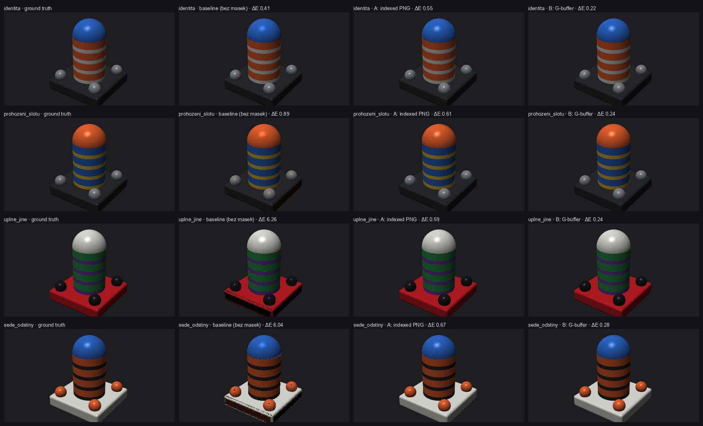
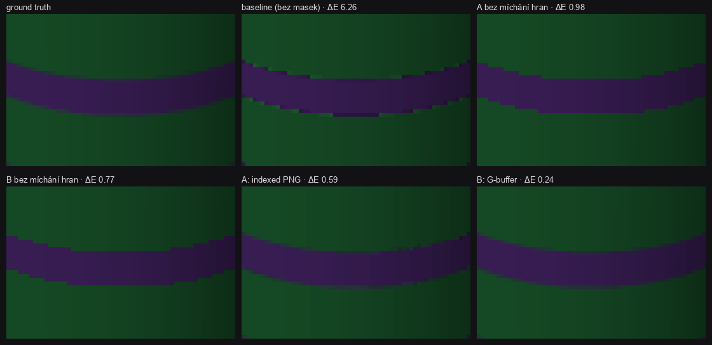

# Repaint – přebarvitelný náhled pro vícebarevné tisky

**Hypotéza:** slicer může do g-code uložit náhled, který tiskárna umí po přemapování
filamentů přebarvit tak, aby odpovídal skutečně zavedeným barvám.

**Výsledek POC:** jde to, a levně. Místo hotových barev se pro každý pixel uloží
*masky*: který materiál (nástroj `Tn`) to je, jak je osvětlený a jaký má odlesk. Na hranách
dvou materiálů se uloží oba materiály a jejich poměr. Barvu pak dopočítá tiskárna:

```
barva = mix(filament[m1], filament[m2], w) × stín + odlesk
```

**[▶ Interaktivní demo](https://xfanta.github.io/repaint/)**: vlevo změň barvy slotů a uvidíš přebarvení všech variant.



## Dokumentace

| dokument | pro koho |
|---|---|
| [docs/SPEC.md](docs/SPEC.md) | **specifikace formátu**: barevný model, chunk `mtRL`, G-buffer, vložení do g-code |
| [docs/SLICER.md](docs/SLICER.md) | implementace ve sliceru: render G-bufferu, downsample, kvantizace palety |
| [docs/FIRMWARE.md](docs/FIRMWARE.md) | implementace v tiskárně: integrace do PNG/QOI dekodéru, C API, náklady, testovací vektory |
| [docs/POC.md](docs/POC.md) | POC: spuštění, testovací scéna, metodika měření, výsledky, omezení |

## Proč to nejde z dnešního RGB náhledu

Z RGB pixelu se dá zkusit odhadnout, kterým filamentem je. Selže to ale u **černé /
šedé / bílé** (stín bílé = šedá = osvětlená černá), u dvou slotů se stejnou barvou,
u odlesků a na hranách. Takový odhad má v měření průměrné ΔE ≈ 6 a 17–18 % viditelně
špatných pixelů. Varianty s maskami mají ΔE < 0,7.

## Dvě varianty

**A) Indexované PNG + privátní chunk `mtRL`** – doporučeno, pokud firmware umí PNG
- Paleta (≤ 256 barev) je rozdělená mezi materiály a jejich hrany. Chunk `mtRL` říká
  pro každou barvu palety `(m1, m2, w, stín, odlesk)`.
- **Tiskárna přepíše jen paletu** (≤ 768 B). Obrazová data se nedekódují znovu.
- **Zpětně kompatibilní:** starý firmware, Connect i prohlížeč chunk ignorují a ukážou
  původní barvy.
- **Menší** než dnešní náhled: 7,8 kB proti 18,5 kB (PNG) / 26,9 kB (QOI).

**B) G-buffer v QOI** – pro firmware, který umí jen QOI, nebo když je potřeba nejvyšší kvalita
- `R` = stín, `G` = odlesk, `B` = dva 4bitové indexy materiálu, `A` = pokrytí nebo váha směsi.
- Tiskárna na výstupu QOI dekodéru spočítá pro každý pixel pár násobení.
- Nejvyšší kvalita (ΔE ≈ 0,25), max. 15 materiálů, 34 kB.
- Není zpětně kompatibilní, takže musí jít jako *další* náhled vedle běžného.

## Výsledky (440×240, 5 materiálů)

Průměrné ΔE76 / podíl pixelů s ΔE > 5, proti náhledu vyrenderovanému rovnou s novými barvami:

| přemapování | bez masek | A | B |
|---|---|---|---|
| prohození slotů | 0,89 / 3,8 % | 0,61 / 1,1 % | 0,24 / 0,8 % |
| úplně jiné barvy | **6,26 / 17,4 %** | 0,59 / 1,2 % | 0,24 / 1,0 % |
| prohození černé/šedé/bílé | **6,04 / 18,3 %** | 0,67 / 1,2 % | 0,28 / 1,0 % |

Míchání materiálů na hranách snížilo 99. percentil chyby z 12–22 na 3–6. Detail hran
s mícháním a bez něj:



Referenční přebarvení existuje ve třech implementacích (Python, C pro firmware, JS
v demu) a všechny tři dávají na testovacích vektorech bajtově shodné výsledky.

## Rychlý start

```bash
python3 poc/make_poc.py
```

```bash
python3 -m http.server 8791
```

Pak otevři http://localhost:8791/demo/ (nebo online: https://xfanta.github.io/repaint/). V demu se barvy slotů mění vlevo. Varianta A
v prohlížeči opravdu jen přepisuje bajty palety v PNG, varianta B běží jako
per-pixel smyčka nad QOI.

## Struktura

```
docs/            specifikace a návody (viz výše)
poc/repaint.py   renderer („slicer“), kodéry A/B, QOI, přebarvení, baseline, metriky
poc/make_poc.py  generuje out/ a vypisuje tabulky
poc/firmware/    referenční C99 implementace pro tiskárnu + test proti vektorům
demo/            interaktivní demo
out/             vygenerované obrázky, metriky, testovací vektory
```
